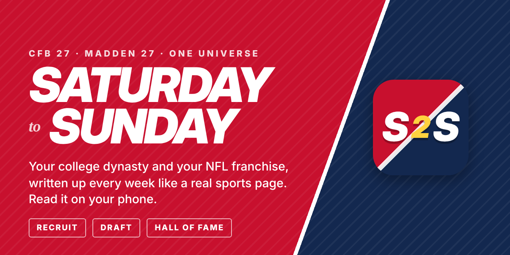

# S2S · Saturday to Sunday

**A vintage ESPN-style sports site, written every week about your College
Football 27 dynasty and your Madden NFL 27 franchise.** Front page, game
stories, the column, power rankings, the draft, recruiting, The Wire, player
cards and team pages. The writing happens on your PC; you read it on your phone.

S2S builds on Zip's Vintage ESPN App and Economy Overhaul: his foundation, with
the Madden side added so a college dynasty and an NFL franchise are one universe.

**Two PDFs for sharing:** [the brochure](docs/S2S-Brochure.pdf) (what it is, why, how it works) and [the quick start](docs/S2S-Quick-Start.pdf) (three steps, one page).

## Start here

You need a Windows PC with your CFB 27 and/or Madden 27 saves on it, a free
ChatGPT account, and a phone on the same Wi-Fi.

1. **Download.** Click the green **Code** button ▸ **Download ZIP**, then
   right-click the zip ▸ **Extract All** (somewhere you'll keep it, like
   `C:\S2S` or Documents).
2. **Open `START HERE`.** It's the first thing in the folder. It looks like a
   phone and walks five steps: start S2S, your save, ChatGPT, your phone, AD
   mode. Each step ticks itself when S2S sees it done.
3. **Double-click `S2S`** when it says so. If Windows says *"Windows protected
   your PC"*, click **More info ▸ Run anyway**. If Node.js isn't installed it
   offers to install it; then double-click again. The first start takes about
   a minute. Everything else lives in the **S2S files** folder; you never need
   to open it.

Then play. Sim a week and the paper is waiting on your phone. The first
Generate only files the week; from your next advance on, every Generate
writes the issue ([SETUP.md](S2S%20files/SETUP.md) section 6 explains why: it's what keeps
the app from spoiling scores the game is still hiding).

S2S reads your saves. The one exception is the Front Office (in beta), which writes
only what you Send from it, after a backup, and checks each change. Your leagues live in your user
folder, apart from the app, so updates never touch them. **Updates:** when a
new version is out, a red dot shows on the Settings gear; tap **Install update**
at the top of Settings and the app updates and restarts itself. What changed is
on this page's **Releases** list. Stuck on something? **Settings ▸ Support** answers the
usual questions.

**Linking a college dynasty and a franchise** (optional): add both saves and
S2S offers to make them one universe, so your college players follow you to
Sunday.

**Optional add-ons** (read-only; the app finds them on its own when installed):
**MyDynasty** (college history, draft stock, playoff odds, player faces),
**MyFranchise** (NFL progression and history) and **Zip's Economy Overhaul**
(your program's money and the Donor Wire). Each is in Settings ▸ your league ▸
Add-ons. **Settings ▸ About** has the why and the roadmap.

## The Front Office: AD mode and Coach mode (beta)

In a beta download, **Office** sits in the bottom bar (tagged BETA). It opens once S2S has read a college week.

**Built on Zip's All in One mod.** The Front Office is made for a college dynasty running the All in One mod with its
Economy Overhaul (ZEO): the Booster Club and its donors, the Donor Ledger and the mod's economy are what the office's
money runs on. Without the mod it still works, on S2S's own money model, with no Booster Club or donors. Use the mod.

- **AD mode: run the business side of your program.** You're the athletic director: the businessman. The coaching (game plans, recruiting, the depth chart) still happens in the game; AD Mode reads it and doesn't run it. Your job is the business: sell your sponsorships (pouring rights, the patch, the stadium's boards, concessions), work the deals, keep your partners happy, and answer to the board, whose grades and your program's prestige set how fast you can grow. About ten minutes a week on your phone, then **Send**. At the end of each season the Recap grades your year and turns it into money for the next one, written into your save. Hire your business staff in tiers, open a slot to bids, sell next season's deals, and know which brands are in your market; your AD score pays credits at the Recap.
- **Coach mode.** The head coach's calls beside the AD's: recruiting (read only for now: S2S reads your board and never writes it), the talent tree, team meetings and 1-on-1s. Its switch is on the office's **Send** page and it starts the next week. The Front Office is college-only for now.
- **What goes into your save:** only what you Send (AD mode's pay, budget and staff moves; Coach mode's talent tree, meetings and 1-on-1s). S2S refuses while the game is running, backs the save up first (the last five, in an `S2S` folder beside it) and reads every change back. Everything else ends in **do it in the game**, with a check that you did.

Testing it? [BETA-TESTERS.md](S2S%20files/BETA-TESTERS.md) says what to try, and **Settings ▸ Support ▸ Report a problem** copies what JJ needs to fix it.

**On your phone:** [PHONE-SETUP.md](S2S%20files/PHONE-SETUP.md), step by step.

**More:** [SETUP.md](S2S%20files/SETUP.md) is the full guide (saves, writers, the
watcher, photos); [FAQ.md](S2S%20files/FAQ.md) answers the usual questions.

### NFL photos

Both leagues ship with game photos; there is nothing to set up. The NFL
library is built once by whoever maintains the app (`tools\nfl-images-build.bat`,
the same way the college one was) and arrives with updates. A club with no
photos uses team-colour art.

### Away from home

Install the free **Tailscale** on the PC and the phone (same account) and
Settings ▸ On your phone shows an **Anywhere** link: one link for home Wi-Fi,
other Wi-Fi, cellular and your other computers. [PHONE-SETUP.md](S2S%20files/PHONE-SETUP.md).

---

## Credits, support and license

- **Built on Zip's work.** S2S starts from Zip's **Vintage ESPN App** and reads
  his **Economy Overhaul** for the Business desk. The foundation is his; go
  find his tools post and give it some love.
- **Support.** S2S is a fan project shared as-is. Please don't take S2S
  questions to Zip's Discord: his tools are his, this one is mine. The ESPN
  app discussion thread is the place to talk about it, but there is no
  promise of help there.
- **License.** Free for your own personal use. Please don't sell it or post
  copies; point people to this page instead. Full terms in [LICENSE](LICENSE).
- **Your saves.** S2S reads your saves, MyDynasty and MyFranchise. Only the
  Front Office writes, and only what you Send, after a backup. S2S
  is not affiliated with EA, ESPN, the NFL or the NCAA.
