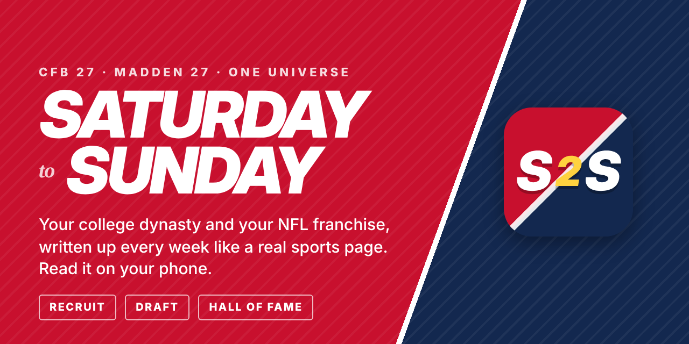

# S2S · Saturday to Sunday

**A vintage ESPN-style sports site, written every week about your College
Football 27 dynasty and your Madden NFL 27 franchise.** Front page, game
stories, the column, power rankings, the draft, recruiting, The Wire, player
cards and team pages. The writing happens on your PC; you read it on your phone.

S2S builds on Zip's Vintage ESPN App and Economy Overhaul: his foundation, with
the Madden side added so a college dynasty and an NFL franchise are one universe.

**Two PDFs for sharing:** [the brochure](docs/S2S-Brochure.pdf) (what it is, why, how it works) and [the quick start](docs/S2S-Quick-Start.pdf) (three steps, one page).

## Start here

You need a Windows PC with your CFB 27 and/or Madden 27 saves on it, a free
ChatGPT account, and a phone on the same Wi-Fi.

1. **Download.** Click the green **Code** button ▸ **Download ZIP**, then
   right-click the zip ▸ **Extract All** (somewhere you'll keep it, like
   `C:\S2S` or Documents).
2. **Double-click `S2S.bat`.** If Windows says *"Windows protected your PC"*,
   click **More info ▸ Run anyway**. If Node.js isn't installed it offers to
   install it; then double-click again. The first start takes about a minute.
3. **Follow the screen.** Your browser opens on a five-step setup:
   **Connect ChatGPT** (one button, free), **Add your save**, **Your team**,
   **On your phone** (scan the code), **Automatic weeks**. Done.

Then play. Sim a week and the paper is waiting on your phone. The first
Generate only files the week; from your next advance on, every Generate
writes the issue ([SETUP.md](SETUP.md) section 6 explains why: it's what keeps
the app from spoiling scores the game is still hiding).

Your saves are only ever read, never written. Your leagues live in your user
folder, apart from the app, so updates never touch them. **Updates:** with
**Settings ▸ This device ▸ Update the app automatically** ticked, new versions
install themselves; otherwise a red dot shows on the Settings gear, and
**Update now** at the top of Settings updates and restarts the app. What changed is in
**Settings ▸ Update log**. Stuck on something? **Settings ▸ Help** answers the
usual questions.

**Linking a college dynasty and a franchise** (optional): add both saves and
S2S offers to make them one universe, so your college players follow you to
Sunday.

**Optional add-ons** (read-only; the app finds them on its own when installed):
**MyDynasty** (college history, draft stock, playoff odds, player faces),
**MyFranchise** (NFL progression and history) and **Zip's Economy Overhaul**
(your program's money and the Donor Wire). Each is in Settings ▸ your league ▸
Add-ons. **Settings ▸ About** has the why and the roadmap.

**On your phone:** [PHONE-SETUP.md](PHONE-SETUP.md), step by step.

**More:** [SETUP.md](SETUP.md) is the full guide (saves, writers, the
watcher, photos); [FAQ.md](FAQ.md) answers the usual questions.

### NFL photos

Both leagues ship with game photos; there is nothing to set up. The NFL
library is built once by whoever maintains the app (`tools\nfl-images-build.bat`,
the same way the college one was) and arrives with updates. A club with no
photos uses team-colour art.

### Away from home

Install the free **Tailscale** on the PC and the phone (same account) and
Settings ▸ On your phone shows an **Anywhere** link: one link for home Wi-Fi,
other Wi-Fi, cellular and your other computers. [PHONE-SETUP.md](PHONE-SETUP.md).

---

## Credits, support and license

- **Built on Zip's work.** S2S starts from Zip's **Vintage ESPN App** and reads
  his **Economy Overhaul** for the Business desk. The foundation is his; go
  find his tools post and give it some love.
- **Support.** S2S is a fan project shared as-is. Please don't take S2S
  questions to Zip's Discord: his tools are his, this one is mine. The ESPN
  app discussion thread is the place to talk about it, but there is no
  promise of help there.
- **License.** Free for your own personal use. Please don't sell it or post
  copies; point people to this page instead. Full terms in [LICENSE](LICENSE).
- **Read-only.** S2S only ever reads your saves, MyDynasty and MyFranchise. It
  is not affiliated with EA, ESPN, the NFL or the NCAA.
